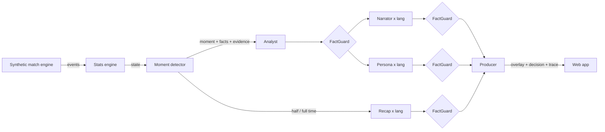

# Matchday Control Room

**A multi-agent broadcast crew that turns synthetic football events into explainable, personalised, on-screen match intelligence in real time.**

Built for the Microsoft x Premier League *Inside the Game: Developer Hackathon*. All data is synthetic and every club and player is fictional.

Football is more than the scoreline. Matchday Control Room watches a live (synthetic) event feed, works out *what* is happening and *why it matters*, and has a crew of specialised agents write the commentary, the on-screen graphics and the recaps. Every viewer gets their own version: a data-hungry analyst, a casual fan, a supporter of either club or someone following one player. Every number on screen is fact-checked against the stats engine before it airs.

## The five stages

| Stage | Where it lives | What it does |
|---|---|---|
| **Ingest** | `mcr/sim`, `WS /ws/match` | Seeded synthetic match engine streams passes, carries, shots, tackles, interceptions, pressure events, possession changes, set pieces and period markers, each with a 22-player positional frame. |
| **Interpret** | `mcr/stats/engine.py` | Incremental match state: possession, xG, pass accuracy, pass difficulty (0-10), pressures per minute, momentum index, *control vs chaos* index, player distance and top speed. |
| **Explain** | `mcr/stats/moments.py`, Analyst agent | Detects key moments (goals, big chances, pressure surges, momentum swings, rhythm changes, elite passes, milestones) with evidence (metric vs. baseline), and the Analyst explains why each one matters. |
| **Render** | Producer agent, `frontend/` | The Producer owns the on-screen slot: it picks overlay type, priority and duration, drops or replaces overlays and logs why. The web app renders a 2D pitch, live player name tags, speed tags, lower thirds, stat cards and recap panels. |
| **Personalise** | Persona agent, `frontend/` | The same moment is rewritten for four audiences (analyst, casual, home fan, away fan) in English and Turkish, plus a player-focus mode with the chosen player's live stats. |

## Agent design



* **Analyst, Narrator, Persona and Recap** are Microsoft Agent Framework `Agent`s sharing one chat client (Microsoft Foundry, Azure OpenAI, or the offline client).
* **FactGuard** checks every generated line: a number that is not in the moment's facts gets the text rejected and retried once with corrective feedback.
* **Recovery**: every call has a timeout, one guarded retry and a deterministic, grounded fallback, so a slow or hallucinating model degrades the broadcast instead of breaking it. The test suite injects a hallucinating, timing-out client to prove this (`tests/test_pipeline.py`).
* **Producer** is a policy agent: one primary overlay slot plus a ticker for player tags, with priority and cooldown rules. Each decision carries a human-readable reason.
* **Shared state** is the deterministic `MatchState`. Agents never compute numbers, they only narrate the ones the stats engine produced.
* **Agent trace**: every step (agent, language, status, latency, retry/fallback reason) is streamed to the UI.
* Minor moments (sprints, shot speeds, milestones) skip the LLM entirely, which keeps cost and latency down.

## Hidden tactical switch

The default demo match (seed 5) has a story baked into the *simulation*, not the analytics: Riverside Athletic silently switch from a counter-attacking low block to a high press at 58'. That change is never emitted as an event. The stats engine and the moment detector have to discover it from the data (pressures per minute against the match baseline), and the crew explains it on air. `test_hidden_tactical_switch_is_detected` keeps this honest.

## Run locally

Requirements: Python 3.11+, Node 20+.

```bash
# backend
cd backend
python -m venv .venv && source .venv/bin/activate
pip install -e ".[dev]"
uvicorn mcr.api.app:app --reload --port 8000

# frontend (second terminal)
cd frontend
npm install
npm run dev   # http://localhost:5173  (proxies /api and /ws to :8000)
```

URL options: `?seed=5&speed=30&lang=tr&mode=analyst&compare=1`. Modes: `analyst`, `casual`, `fan`, `player`.

Or as one container: `docker build -t mcr . && docker run -p 8000:8000 mcr` and open http://localhost:8000.

### Use a real model

By default `MCR_LLM=offline`, so everything runs with no cloud account. To use Microsoft Foundry:

```bash
export MCR_LLM=foundry
export FOUNDRY_PROJECT_ENDPOINT="https://<resource>.services.ai.azure.com/api/projects/<project>"
export FOUNDRY_MODEL="gpt-4.1-mini"   # your model deployment name
az login                              # DefaultAzureCredential
```

Or Azure OpenAI: `MCR_LLM=azure_openai`, `AZURE_OPENAI_ENDPOINT`, `AZURE_OPENAI_DEPLOYMENT`, `AZURE_OPENAI_API_KEY`.

Or GitHub Models (free tier, no Azure subscription needed): `MCR_LLM=github_models`, `GITHUB_TOKEN` (a fine-grained token with the *Models: read* permission), optional `GITHUB_MODEL` (default `openai/gpt-4o-mini`).

### Deploy to Azure Container Apps

```bash
azd auth login
azd env set MCR_LLM foundry               # optional
azd env set FOUNDRY_PROJECT_ENDPOINT ...  # optional
azd up
```

`infra/main.bicep` provisions Log Analytics, a container registry, a user-assigned managed identity, a Container Apps environment and the app (scale to zero, HTTP autoscaling). When using Foundry, grant the app identity the *Azure AI User* role on the Foundry project.

## Synthetic data

```bash
python -m mcr.sim --seed 5 --out data/match_5.jsonl --frames
curl "localhost:8000/api/match/5/events?format=csv" > match_5.csv
```

The engine models tactical profiles (pressing intensity, directness, tempo, block depth, width), pass success from distance, pressure and progression, transition (counter-attack) windows after turnovers, and shot outcomes from a transparent distance-and-angle xG model (`mcr/stats/xg.py`). Seeds are deterministic; tests assert realistic ranges for passes, shots, goals and pass accuracy.

## Tests

```bash
cd backend && pytest
```

## Project layout

```
backend/
  mcr/sim/        synthetic match engine, fictional squads, CLI
  mcr/stats/      match state, xG, pass difficulty, momentum, control vs chaos, moment detection
  mcr/agents/     crew (Agent Framework agents), FactGuard, Producer, templates, chat clients
  mcr/api/        FastAPI app: WebSocket stream + dataset export
  tests/
frontend/         React + Vite broadcast UI
infra/            Bicep for Azure Container Apps (azd)
```

## License

MIT
