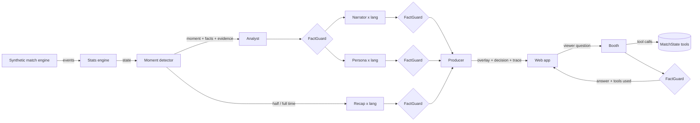

# Matchday Control Room

**A multi-agent broadcast crew that turns synthetic football events into explainable, personalised, on-screen match intelligence in real time.**

Built for the Microsoft x Premier League *Inside the Game: Developer Hackathon*. All data is synthetic and every club and player is fictional.

Football is more than the scoreline. Matchday Control Room watches a live (synthetic) event feed, works out *what* is happening and *why it matters*, and has a crew of specialised agents write the commentary, the on-screen graphics and the recaps. Every viewer gets their own version: a data-hungry analyst, a casual fan, a supporter of either club or someone following one player. Every number on screen is fact-checked against the stats engine before it airs.

## The five stages

| Stage | Where it lives | What it does |
|---|---|---|
| **Ingest** | `mcr/sim`, `WS /ws/match` | Seeded synthetic match engine streams passes, carries, shots, tackles, interceptions, pressure events, possession changes, set pieces and period markers, each with a 22-player positional frame. |
| **Interpret** | `mcr/stats/engine.py` | Incremental match state: possession, xG, pass accuracy, pass difficulty (0-10), pressures per minute, momentum index, *control vs chaos* index, player distance and top speed. |
| **Explain** | `mcr/stats/moments.py`, Analyst agent | Detects key moments (goals, big chances, pressure surges, momentum swings, rhythm changes, elite passes, milestones) with evidence (metric vs. baseline), and the Analyst explains why each one matters. |
| **Render** | Producer agent, `frontend/` | The Producer owns the on-screen slot: it picks overlay type, priority and duration, drops or replaces overlays and logs why. The web app renders a 2D pitch, live player name tags, speed tags, lower thirds, stat cards and recap panels. |
| **Personalise** | Persona agent, `frontend/` | The same moment is rewritten for four audiences (analyst, casual, home fan, away fan) in English and Turkish, plus a player-focus mode with the chosen player's live stats. |

## Agent design



* **Analyst, Narrator, Persona, Recap and Booth** are Microsoft Agent Framework `Agent`s sharing one chat client (Microsoft Foundry, Azure OpenAI, Foundry Local, or the offline client).
* **FactGuard** checks every generated line: a number that is not in the moment's facts gets the text rejected and retried once with corrective feedback.
* **Recovery**: every call has a timeout, one guarded retry and a deterministic, grounded fallback, so a slow or hallucinating model degrades the broadcast instead of breaking it. The test suite injects a hallucinating, timing-out client to prove this (`tests/test_pipeline.py`).
* **Producer** is a policy agent: one primary overlay slot plus a ticker for player tags, with priority and cooldown rules. Each decision carries a human-readable reason.
* **Shared state** is the deterministic `MatchState`. Agents never compute numbers, they only narrate the ones the stats engine produced.
* **Agent trace**: every step (agent, language, status, latency, retry/fallback reason) is streamed to the UI.
* Minor moments (sprints, shot speeds, milestones) skip the LLM entirely, which keeps cost and latency down.

## Ask the booth

Viewers can type a question ("Why is Riverside pressing so much?", "Kim en çok koştu?") or tap a suggestion. The **Booth** agent does not see the stats: it has to fetch them through five read-only tools over the shared `MatchState` (`match_overview`, `team_stats`, `player_stats`, `key_moments`, `top_players`), and FactGuard checks the answer against exactly what those tools returned. The UI shows the answer with the tool calls behind it.

* **native** mode: the model chooses the tools (Agent Framework function calling). Default for hosted models.
* **planned** mode: a deterministic planner picks the tools from the question and the model writes the answer from their results. Default for on-device models, which are unreliable at tool calls (`MCR_BOOTH_TOOLS=native` overrides).
* A native answer that calls no tool, or quotes an unknown number, is retried in planned mode, then falls back to a templated, grounded answer.

## Evaluation

```bash
cd backend
python -m mcr.eval                                   # writes eval/results-offline.md and .json
MCR_LLM=foundry_local python -m mcr.eval --moments 10
```

It measures four things: whether the analytics find the hidden tactical switch (20 seeds), how well FactGuard separates grounded lines from lines with an invented or nudged number, how each agent behaves against the configured model with the cache off (ok / retried / fallback, p50 and p95 latency), and whether the Booth picks the right tools for a fixed question set. Current offline results: [eval/results-offline.md](eval/results-offline.md).

## Observability

Every moment, agent call, booth question and tool call is an OpenTelemetry span, with Agent Framework's own GenAI spans (`invoke_agent`, `chat`, `execute_tool`) nested underneath, so a trace shows the whole hand-off chain. Off by default:

```bash
# local: Aspire Dashboard on http://localhost:18888
docker run --rm -d -p 18888:18888 -p 4318:18890 -e DOTNET_DASHBOARD_UNSECURED_ALLOW_ANONYMOUS=true mcr.microsoft.com/dotnet/aspire-dashboard:latest
export OTEL_EXPORTER_OTLP_ENDPOINT=http://localhost:4318

# or print spans to the console
export MCR_OTEL=1
```

On Azure, `infra/main.bicep` provisions Application Insights and the app sends traces there automatically.

## Hidden tactical switch

The default demo match (seed 5) has a story baked into the *simulation*, not the analytics: Riverside Athletic silently switch from a counter-attacking low block to a high press at 58'. That change is never emitted as an event. The stats engine and the moment detector have to discover it from the data (pressures per minute against the match baseline), and the crew explains it on air. `test_hidden_tactical_switch_is_detected` keeps this honest.

## Run locally

Requirements: Python 3.11+, Node 20+.

```bash
# backend
cd backend
python -m venv .venv && source .venv/bin/activate
pip install -e ".[dev]"
uvicorn mcr.api.app:app --reload --port 8000

# frontend (second terminal)
cd frontend
npm install
npm run dev   # http://localhost:5173  (proxies /api and /ws to :8000)
```

URL options: `?seed=5&speed=30&lang=tr&mode=analyst&compare=1`. Modes: `analyst`, `casual`, `fan`, `player`.

Or as one container: `docker build -t mcr . && docker run -p 8000:8000 mcr` and open http://localhost:8000.

### Use a real model

By default `MCR_LLM=offline`, so everything runs with no cloud account. To use Microsoft Foundry:

```bash
export MCR_LLM=foundry
export FOUNDRY_PROJECT_ENDPOINT="https://<resource>.services.ai.azure.com/api/projects/<project>"
export FOUNDRY_MODEL="gpt-4.1-mini"   # your model deployment name
az login                              # DefaultAzureCredential
```

Or Azure OpenAI: `MCR_LLM=azure_openai`, `AZURE_OPENAI_ENDPOINT`, `AZURE_OPENAI_DEPLOYMENT`, `AZURE_OPENAI_API_KEY`.

Or run fully on-device with **Microsoft Foundry Local** (no cloud account; install it with `brew install microsoft/foundrylocal/foundrylocal` on macOS or `winget install Microsoft.FoundryLocal` on Windows): `MCR_LLM=foundry_local`, optional `FOUNDRY_LOCAL_MODEL` (default `phi-4-mini`). The first run downloads the model. If the SDK cannot start the service (newer CLIs renamed `foundry service` to `foundry server`), start it yourself and point the app at it:

```bash
foundry server start --port 39839 --idle-timeout 0
foundry model load phi-4-mini
export FOUNDRY_LOCAL_ENDPOINT=http://127.0.0.1:39839
```

Every validated model answer is cached in `backend/.cache/` (matches are seeded, so replays are instant; the trace shows `cached`), and `MCR_LLM_RPM` rate-limits calls for hosted tiers. To fill the cache before a demo:

```bash
MCR_LLM=foundry_local python -m mcr.agents.prewarm --seed 5
```

### Deploy to Azure

```bash
azd auth login
azd env new mcr --location eastus2
azd up
```

`infra/main.bicep` provisions everything the app needs, keyless:

* a **Microsoft Foundry** resource with a project and a `gpt-4.1-mini` deployment (GlobalStandard, `foundryModelCapacity` thousand tokens per minute),
* a user-assigned managed identity with *Azure AI User* on the Foundry resource and *AcrPull* on the registry,
* Log Analytics and **Application Insights** (agent traces),
* a container registry and a **Container Apps** environment running the app (scale to zero, HTTP autoscaling, WebSockets).

The app starts with `MCR_LLM=foundry` pointed at the new project. To skip the model and deploy offline: `azd env set MCR_DEPLOY_FOUNDRY false`. Pick a region where the model is available for GlobalStandard (for example `eastus2` or `swedencentral`).

## Synthetic data

```bash
python -m mcr.sim --seed 5 --out data/match_5.jsonl --frames
curl "localhost:8000/api/match/5/events?format=csv" > match_5.csv
```

The engine models tactical profiles (pressing intensity, directness, tempo, block depth, width), pass success from distance, pressure and progression, transition (counter-attack) windows after turnovers, and shot outcomes from a transparent distance-and-angle xG model (`mcr/stats/xg.py`). Seeds are deterministic; tests assert realistic ranges for passes, shots, goals and pass accuracy.

## Tests

```bash
cd backend && pytest
```

## Project layout

```
backend/
  mcr/sim/        synthetic match engine, fictional squads, CLI
  mcr/stats/      match state, xG, pass difficulty, momentum, control vs chaos, moment detection
  mcr/agents/     crew and booth (Agent Framework agents), FactGuard, Producer, templates, chat clients
  mcr/eval/       evaluation harness (python -m mcr.eval)
  mcr/telemetry.py OpenTelemetry setup (OTLP, Azure Monitor, console)
  mcr/api/        FastAPI app: WebSocket stream + dataset export
  tests/
frontend/         React + Vite broadcast UI
infra/            Bicep for Foundry + Container Apps + Application Insights (azd)
eval/             evaluation results
```

## License

MIT
